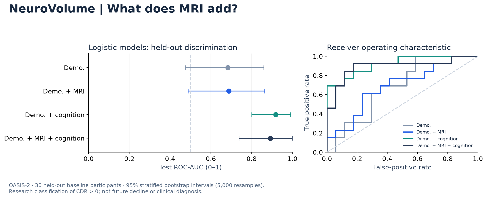

# NeuroVolume

**Does adding MRI-derived brain volume improve classification of recorded cognitive impairment?**

A reproducible computational neuroscience project using **150 OASIS-2 participants**, four feature sets, and three model families. Includes **12 trained models**, a research notebook, a responsive model explorer, and tests that verify Python/browser prediction parity.

**Project evidence:** [Technical report (PDF)](paper/NeuroVolume.pdf) · [Editable report](paper/NeuroVolume.md) · [Reproduce the work](docs/REPRODUCIBILITY.md) · [Contributions](docs/CONTRIBUTIONS.md) · [Resume wording and claim boundaries](docs/RESUME_EVIDENCE.md) · [Reporting map](docs/REPORTING_MAP.md)

The report is self-published and has not been peer reviewed. Arjun Mathane directed the project. Current ADNI work is an importer and feasibility audit, not a validated decline model.



## The finding

In the prespecified logistic comparison, adding MRI measurements changed held-out ROC-AUC from **0.683 to 0.688**. The paired difference was **+0.005**, with a 95% bootstrap interval of **−0.158 to +0.167**. Development cross-validation suggested an improvement that was not clearly confirmed on the test set.

This is a **small, inconclusive incremental-value result**, not a claim that MRI is unhelpful. Models including cognitive scores classified contemporaneous impairment more successfully, but cognitive scores already measure a related clinical construct. Some benchmarks achieved 27/30 correct predictions (90%); that is not a validated winning model or evidence of detection before symptoms.

[Complete results](reports/RESULTS.md) · [Analysis notebook](analysis.ipynb) · [Model card](docs/MODEL_CARD.md) · [Fixed analysis protocol](docs/PROTOCOL.md)

## Standalone workbench

**New in v0.3.0:** paired invented-scenario comparisons, explicit training-median substitutions, and version-checked JSON save/restore. Pin an example as reference A, edit B, and download both for reproducible exploration. The evidence tables now include sensitivity and specificity; synthetic survival curves also have numeric predictions. See the [workbench guide](docs/WORKBENCH.md).

For a ready-to-open copy, download **[NeuroVolume-v0.3.0.html](https://github.com/arjunmathane/NeuroVolume/releases/download/v0.3.0/NeuroVolume-v0.3.0.html)** and open it in your browser. No installation is needed. The GitHub source-file view below displays code; download the file to run the application.

Open **[standalone/index.html](standalone/index.html)** in Safari, Chrome, or another browser. It contains the original current-impairment logistic models, exploratory future-impairment pilot, and a clearly labeled synthetic survival laboratory with interactive curves. Predictions run offline; no server, installation, API key, or login is needed. This directory can also be served by any static host, including GitHub Pages. Public hosting has not been configured in this release.

Open `neurovolume.code-workspace` in VS Code to inspect and develop the project. VS Code is an editor; it does not change the underlying scientific validity or authorship of the project.

The **ADNI extension** now has a dictionary-reviewed local importer and a cohort feasibility audit. Authorized data remain private and are excluded from the upload archive. The reviewed MRI subset does not support a decline fit under the declared rules; older-release acquisition and real-data survival validation remain pending. See [current status](docs/STATUS.md) and [importer methods](docs/ADNI_IMPORT.md).

The **future pilot** uses 43 participants with adequate observed follow-up (8 events, 35 non-events), excluding 42 with insufficient follow-up. Mean repeated out-of-fold AUC: age-only **0.746**, age + normalized brain volume **0.739**. No independent test set or clinical validation; these results do not establish added MRI value. See [pilot protocol and results](docs/FUTURE_DECLINE.md).

## Original React demo: current impairment only

The demo runs the actual trained logistic models locally in your browser. It supports four feature sets, missing-value imputation, measurement validation, log-odds contributions, and synthetic-scenario export. The Evidence tab contains all twelve benchmark results.

Requires Node.js 24 (or a compatible Node >=22.13 installation).

```sh
cd demo
npm ci
npm run dev
```

Open the local address printed by the server (normally http://localhost:3000). No Python, API key, patient data, or retraining is needed to run the demo. This is a Vinext React app; it requires a Node development server or compatible Workers hosting and is not a plain GitHub Pages static directory.

The explorer starts with **invented example measurements**, not a participant record. It classifies CDR > 0 versus CDR = 0 and displays a model score, **not calibrated medical risk, a clinical diagnosis, or future decline**. It accepts numeric MRI-derived measurements, not raw brain scans. There is no patient-upload or server-side input storage feature.

## Python inference and verification

Requires Python 3.12. From the repository root:

```sh
python3.12 -m venv .venv
source .venv/bin/activate
pip install -r requirements.txt
python -m neurovolume.predict --input examples/synthetic.json --family mri
python -m pytest -q
```

On Windows, activate with `.venv\Scripts\activate`. Node is needed for cross-language parity tests. A test that checks local participant split files is skipped in the public bundle because those private files are intentionally excluded.

The default predictor uses portable JSON parameters. The twelve sklearn pipelines are also in `models/`; only load joblib artifacts you trust. They require the pinned scikit-learn version. `models/logistic.json` is the portable alternative used by the demo.

## Reproduce the analysis

Obtain your own authorized OASIS-2 demographic workbook from the [official dataset page](https://sites.wustl.edu/oasisbrains/home/oasis-2/) and follow the [current data-use terms](https://sites.wustl.edu/oasisbrains/home/access/). See [data provenance](docs/DATA.md). Raw data are not distributed here.

Save the workbook locally as `data/oasis2.xlsx`, then run:

```sh
python -m neurovolume.train --data data/oasis2.xlsx
python scripts/sync_demo.py
python scripts/make_figures.py
python -m pytest -q
```

Training recreates model files, aggregate results, and local-only split/prediction audits under ignored `private/`. Training and the 5,000-resample intervals can take several minutes. Do not add `data/` or `private/` to version control. The source SHA-256 is recorded in `reports/results.json`; verify it when reproducing this exact release. Narrative markdown describes this release and must be reviewed if you run different data or change the protocol.

## Study design

- **One actual first visit per person:** 373 original sessions become 150 independent baseline rows. Missing baseline fields are not replaced by future measurements.
- **Outcome:** recorded baseline CDR > 0, including very mild/questionable impairment. This is not a biomarker-confirmed Alzheimer diagnosis.
- **Feature sets:** demographics; demographics + eTIV/nWBV; demographics + MMSE; all combined.
- **No direct target leakage:** CDR, longitudinal Group, IDs, future visits, and visit timing are excluded. ASF is omitted as redundant with intracranial scaling.
- **Fixed comparison:** logistic regression is primary; random forest and gradient boosting are prespecified benchmarks. No tuning against test performance.
- **Validation:** 120 development / 30 test participants, stratified split seed 42. Five-fold development CV repeated three times. Preprocessing is learned inside each training fold.
- **Reporting:** ROC-AUC, balanced accuracy, ordinary accuracy, sensitivity, specificity, precision, Brier score, confusion counts, and paired bootstrap AUC differences.

The demo and reported results use models fitted only on the 120 development participants. Test participants are not included in a later “final model” refit.

## What is included

- `neurovolume/`: training, validation, portable inference, and command-line prediction.
- `models/`: twelve trained pipelines and four portable logistic models.
- `demo/`: original React/TypeScript research workspace and inference engine.
- `web/`: maintained offline-workbench template, UI, portable inference and scenario files.
- `analysis.ipynb`: executed walkthrough of the saved experiment and synthetic inference.
- `reports/`: measured results, development fold scores, and PNG/SVG figures.
- `tests/`: baseline leakage, preprocessing, metric, artifact consistency, and prediction parity checks.
- `docs/`: protocol, model card, data access, presentation guide, and future-decline roadmap.
- `.github/workflows/verify.yml`: Python tests, TypeScript checking, and demo build.

## Limitations and longitudinal extension

Only 30 test participants, one selected research cohort, and coarse whole-brain measurements constrain the conclusion. Scores are not clinically calibrated. Bootstrap intervals condition on fitted models and sample class balance; they omit training and site uncertainty. MMSE can make classification easier without establishing early detection. Comparing many benchmark results and then highlighting the largest score would be optimistic.

[Future decline](docs/FUTURE_DECLINE.md) is a separate phase. This workbook has only 15 people with baseline CDR = 0 and a later CDR > 0 under our operational endpoint. A prognostic study needs a defined horizon, censoring rules, and preferably a larger cohort. An exploratory prognostic pilot is now included in the standalone workbench; it is not part of the original hosted React demo.

## Attribution and contributions

Data were provided by OASIS. OASIS-2: Longitudinal; Principal Investigators: D. Marcus, R. Buckner, J. Csernansky, J. Morris; P50 AG05681, P01 AG03991, P01 AG026276, R01 AG021910, P20 MH071616, U24 RR021382.

Marcus DS et al. (2010). *Open Access Series of Imaging Studies (OASIS): Longitudinal MRI Data in Nondemented and Demented Older Adults*. Journal of Cognitive Neuroscience, 22, 2677–2684. [doi:10.1162/jocn.2009.21407](https://doi.org/10.1162/jocn.2009.21407).

The project compares demographic, MRI-derived and cognitive feature sets using fixed evaluation protocols. No clinical validation or scientific novelty is claimed. [Project explanation and accurate résumé wording](docs/PROJECT_GUIDE.md).

MIT license applies to original source code only. OASIS data and trained artifacts are not relicensed under MIT; see [LICENSE](LICENSE) and [data terms](docs/DATA.md).

## Next-study preparation

The repository now includes a tested canonical longitudinal importer, synthetic fixtures, a synthetic cohort audit with follow-up visualization and report download, and an [ADNI proposed-use draft](docs/ADNI_ACCESS_DRAFT.md). Read the [protocol draft](docs/NEXT_STUDY_PROTOCOL.md) and [input contract](docs/LONGITUDINAL_SCHEMA.md).

The [survival framework](docs/SURVIVAL_FRAMEWORK.md) now fits interval-censored Weibull models, compares age + cognition against added hippocampal volume, evaluates held-out observation likelihood, and exports matching browser predictions. Bundled survival models use **600 invented participants**, with 450 training and 150 held out; these establish software operation only. They provide no clinical predictive evidence.

ADNI application approval has been verified. A dictionary-reviewed ADNI adapter and local feasibility audit are implemented. Controlled ADNI records remain private; no fitted real-cohort survival model or external validation is supplied. The reviewed MRI subset does not support training under the declared rules. Older-release acquisition, source review and real-cohort protocol lock remain pending.
